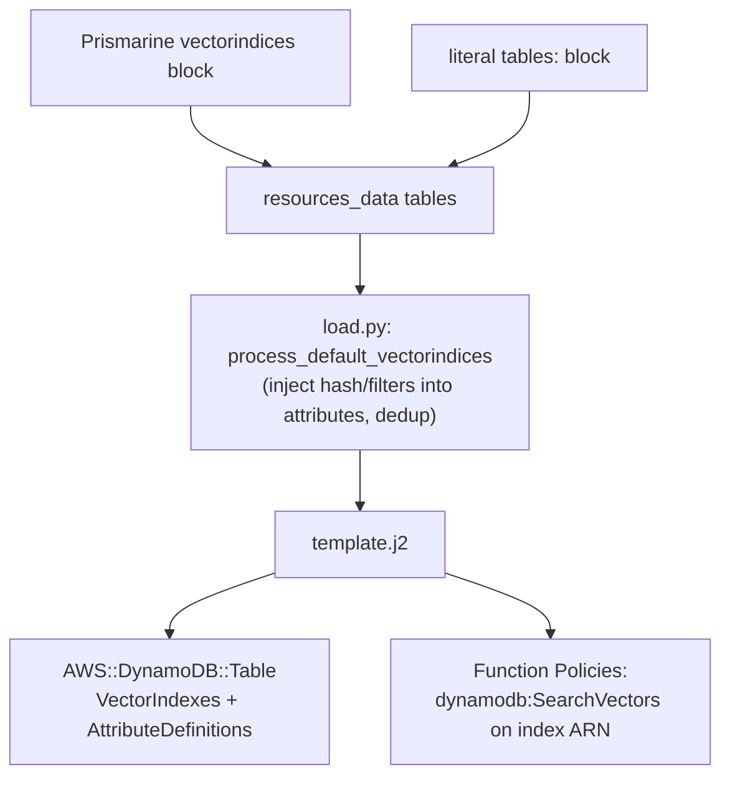

# Spec: EasySAM CloudFormation Support for DynamoDB Vector Indexes

_Derived from `docs/seed/vector-indices.md` (brainstorm recommended Approach C, hybrid).
Planning decisions in `docs/plans/vector-indices.questions.md` (all defaults applied,
non-interactive Autoflow run)._

_Pass-1 critique (`docs/critiques/vector-indices.md`) applied: E1 (schema `dependencies`
forbidding `filters` without `hash`; `SearchSchema` rendered only when `hash` present),
E2 (guard `function.tables` null/undefined in the IAM membership check), E3 (deduplicate
injected attributes strictly against `table['attributes']`, updating the set across indices).
Also folded E4's schema bounds (name pattern/length, `maxItems` on `vectorindices`/`filters`).
💡 Recommendations (P1, E5, E6, P2, E7) and 🤔 Questions (P3) are retained in the critique
report for human review._

_Pass-2 task-level critique (`docs/critiques/vector-indices-tasks.md`) applied: T1 (correct
Jinja snippet indentation under `Properties:`/`Policies:` in §3/§4 and the task files), T2
(example uses the imported-backend layout, not an invalid central `functions:` block), T3
(example never uses schema-invalid `tables: null`; the null-guard is a template unit test on a
synthetic dict). Also folded T7 (test fixtures include required `prefix`/`attributes`), T8
(task-04 depends on task-03), T9 (example `.gitignore`). 💡 T4/T5/T6/T10 retained in the
task-level report for human review._

## Problem Statement

Prismarine (PR #4, "Vector Indices") emits a `vectorindices` block into the EasySAM table
dict, but EasySAM silently ignores it. EasySAM must consume that block and render DynamoDB
**native vector indexes** into CloudFormation via the official `AWS::DynamoDB::Table`
`VectorIndexes` property, grant functions that reference a vector-indexed table permission to
call `SearchVectors` on the index, and ship a working end-to-end example. Tables without a
vector index must continue to generate byte-identical CloudFormation.

EasySAM does **not** generate embeddings and does **not** implement the `SearchVectors`
runtime call (that lives in Prismarine's generated client). This change is provisioning +
IAM access only.

## Requirements

User-observable acceptance criteria:

- **R1 — Schema accepts `vectorindices`.** A table definition (in `resources.yaml`, an
  imported `easysam.yaml`, or a Prismarine-synthesized table) may carry a `vectorindices`
  array. Each entry requires `name`, `attribute`, `dimensions`, `distance`; optional `hash`
  (string) and `filters` (array of strings). `distance` ∈ {`COSINE`, `EUCLIDEAN`,
  `DOT_PRODUCT`}; `dimensions` is an integer in `[1, 4096]`. **`filters` requires `hash`**
  (a `SearchSchema` with inline filters is invalid without a `HASH` partition key — DynamoDB
  rejects it), enforced via JSON Schema `"dependencies": {"filters": ["hash"]}`. The `name`
  matches `^[a-zA-Z0-9_.-]+$` (length 3..255); at most 5 `vectorindices` per table; at most
  18 `filters` per index (CloudFormation quotas). The key is accepted in **both**
  `schemas.json` and `local_schemas.json`. A table without `vectorindices` is unaffected.
  (Critique E1, E4)
- **R2 — `VectorIndexes` rendered.** For a table with `vectorindices`, the generated
  `AWS::DynamoDB::Table` `Properties` includes a `VectorIndexes` list. Each entry maps:
  `name`→`IndexName`, `dimensions`→`Dimensions`, `distance`→`DistanceFunction`,
  `attribute`→`VectorAttribute.AttributeName`, plus `Projection: {ProjectionType: ALL}`. A
  `SearchSchema` list is emitted **only when `hash` is present** (never for `filters` alone):
  `hash`→`{AttributeName, SearchSchemaElementType: HASH}` followed by each `filters` entry →
  `{AttributeName, SearchSchemaElementType: INLINE_FILTER}`. The HASH element precedes the
  INLINE_FILTER elements. (Critique E1)
- **R3 — SearchSchema attributes appear in `AttributeDefinitions`.** Every `hash` and
  `filters` attribute name is present in the table's `AttributeDefinitions` with
  `AttributeType: S`, deduplicated **strictly against `table['attributes']`** (the only list
  the template renders into `AttributeDefinitions`) — not against GSI `indices` attributes —
  and against attributes already injected for earlier vector indexes on the same table. An
  attribute already in `table['attributes']` keeps its existing definition and is not
  duplicated. The vector `attribute` itself is **not** added to `AttributeDefinitions` (the
  embedding is not a key attribute). (Critique E3)
- **R4 — `SearchVectors` IAM.** A function whose `resources.tables` list includes a
  vector-indexed table receives an inline IAM statement granting `dynamodb:SearchVectors`,
  scoped to each vector index ARN of that table
  (`!Sub "${<TableLogicalId>.Arn}/index/<index-name>"`). A function that references only
  non-vector tables gets no such statement.
- **R5 — Byte-identical for non-vector tables.** Generating a project with no `vectorindices`
  anywhere produces output identical to the pre-change template for the DynamoDB and function
  sections.
- **R6 — Working example.** A new `example/vectorindices/` app generates successfully via
  `generate(...)`, producing a table with `VectorIndexes` and a function with the
  `SearchVectors` permission.
- **R7 — On-demand billing.** Vector-indexed tables render `BillingMode: PAY_PER_REQUEST`
  (already EasySAM's hardcoded default; no regression).

## Background (codebase internals)

- **Rendering** is pure Jinja2 over a plain dict. `generate.py::generate` loads
  `resources_data`, builds a Jinja `Environment` (search path = package dir + project dir),
  renders `template.j2` with the whole dict as context, then `write_result` strips blank
  lines. There is no troposphere/Mako.
- **Tables** are rendered in `template.j2`'s `# Tables` section (~lines 406–470):
  `table.attributes` → `AttributeDefinitions` (default `AttributeType: S` when no `type`) +
  two-pass HASH-then-RANGE `KeySchema`; `table.indices` → `GlobalSecondaryIndexes` (guarded
  by ``, `Projection: ProjectionType: ALL` hardcoded);
  `BillingMode: PAY_PER_REQUEST` hardcoded; `table.trigger` → `StreamSpecification`;
  `table.ttl` → `TimeToLiveSpecification`. Table logical id = `{{ prefix }}{{ table_name }}`
  (raw `prefix`, no dash-strip); physical name `!Sub {{ prefix }}{{ table_name }}-${Stage}`.
- **Functions**: `template.j2` function `Policies:` block emits, per `function.tables`,
  `- DynamoDBCrudPolicy: {TableName: !Ref {{ prefix }}{{ table }}}`. An established inline
  precedent is the **stream-trigger** block, which iterates `tables.items()`, matches
  `table.trigger.function == function_name`, and emits an inline statement scoped by
  `!GetAtt {{ prefix }}{{ table_name }}.StreamArn`. The `SearchVectors` statement follows this
  exact cross-reference idiom.
- **Preprocessing**: `load.py::preprocess_defaults` calls a series of
  `process_default_*(resources_data, errors)` steps (searches, functions, streams, tables,
  paths). `process_default_tables` already normalizes triggers in place. Prismarine tables are
  merged into `resources_data['tables']` by `preprocess_prismarine` **before**
  `preprocess_defaults` runs, so a defaults step sees both literal and Prismarine tables.
- **Validation**: `validate_schema.py::validate` runs Draft7 against `schemas.json`;
  imported files validate against `local_schemas.json`. `tables_schema` has
  `additionalProperties: false` in both files, so a new `vectorindices` key must be declared
  or validation rejects it. Note: `schemas.json`'s `table_attribute_schema` lacks a `type`
  field while `local_schemas.json`'s already has the `S`/`N`/`B` enum — injected attributes
  use the default-`S` path and need no `type`, so this asymmetry does not block R3.
- **Tests**: `pytest` via `uv run pytest`. `test_fifoqueue.py` / `test_dynamottl.py` register
  SAM-tag YAML constructors (`!GetAtt`, `!Sub`, `!Ref`), call `generate(cliparams,
  example_path, [], deploy_ctx)` against an `example/` fixture, assert `not errors`, then
  `yaml.safe_load` the written `template.yml` and assert on the parsed dict. `test_fifoqueue.py`
  also unit-tests schema acceptance/rejection via `validate(...)` directly.

### CloudFormation `VectorIndexes` (verified against AWS docs)

`AWS::DynamoDB::Table` has a native `VectorIndexes` property (array of `VectorIndex`):

```yaml
VectorIndexes:
  - IndexName: <string>            # 3..255, [a-zA-Z0-9_.-]+
    Dimensions: <int>             # 1..4096
    DistanceFunction: COSINE | DOT_PRODUCT | EUCLIDEAN
    VectorAttribute:
      AttributeName: <string>
    Projection:
      ProjectionType: ALL
    SearchSchema:                 # optional; >=1 when present
      - AttributeName: <string>   # MUST also be in AttributeDefinitions
        SearchSchemaElementType: HASH | INLINE_FILTER
```

Two load-bearing constraints: (1) every `SearchSchema` attribute must also be declared in
`AttributeDefinitions` (drives R3; overturns Prismarine's Critique E5 at the CloudFormation
layer); (2) CloudFormation permits only one index change (a GSI **or** a vector index, not
both) per single stack operation — a documented operational caveat, not an EasySAM-enforced
rule. Vector indexes require `BillingMode: PAY_PER_REQUEST`.

## Constraints to respect

- Byte-identical output for non-vector tables and functions (R5).
- Vector indexes require on-demand billing — already satisfied by the hardcoded
  `PAY_PER_REQUEST`.
- Up to 5 vector indexes per table; `1 <= dimensions <= 4096` (schema-enforced).
- Injected `hash`/`filters` attributes default to `AttributeType: S`; numeric filters are a
  documented limitation.
- Relative paths only in all artifacts.

## Architecture



Hybrid split (brainstorm Approach C): the attribute-injection/dedup is done in Python
(`load.py`), where set logic is natural and unit-testable; the `VectorIndexes` rendering and
the `SearchVectors` IAM cross-reference live in `template.j2`, reusing the stream-trigger
precedent.

## Proposed Solution

1. **Schema (both files).** Add a `vector_index_schema` definition and a `vectorindices`
   array property to `tables_schema` in `schemas.json` and `local_schemas.json`:

   ```json
   "vector_index_schema": {
     "type": "object",
     "properties": {
       "name": {"type": "string", "pattern": "^[a-zA-Z0-9_.-]+$", "minLength": 3, "maxLength": 255},
       "attribute": {"type": "string"},
       "dimensions": {"type": "integer", "minimum": 1, "maximum": 4096},
       "distance": {"type": "string", "enum": ["COSINE", "EUCLIDEAN", "DOT_PRODUCT"]},
       "hash": {"type": "string"},
       "filters": {"type": "array", "items": {"type": "string"}, "maxItems": 18}
     },
     "required": ["name", "attribute", "dimensions", "distance"],
     "dependencies": {"filters": ["hash"]},
     "additionalProperties": false
   }
   ```
   and inside `tables_schema.properties`:
   `"vectorindices": {"type": "array", "maxItems": 5, "items": {"$ref": "#/definitions/vector_index_schema"}}`.
   The `dependencies` keyword enforces that `filters` cannot appear without `hash` (Critique
   E1); the `name` pattern/length and `maxItems` bounds catch malformed names and quota
   overruns at validation time rather than deploy time (Critique E4).

2. **Preprocessing (`load.py`).** Add `process_default_vectorindices(resources_data, errors)`
   and call it from `preprocess_defaults` (after `process_default_tables`). For each table
   with a non-empty `vectorindices`: seed a `seen` set from the **existing
   `table.get('attributes', [])` names only** (NOT GSI `indices` attributes — the template
   renders `AttributeDefinitions` solely from `table.attributes`, so an attribute present only
   in a GSI block must still be injected; Critique E3). Then, iterating indices in order, for
   each index's `hash` and each `filters` entry: if the name is not in `seen`, append
   `{'name': <attr>}` to `table['attributes']` **and add it to `seen`** so a filter attribute
   shared across multiple vector indexes on the same table is injected exactly once. Idempotent
   and dedup-safe; no change when `vectorindices` is absent.

3. **Template — `VectorIndexes` (`template.j2`).** After the GSI block and before
   `BillingMode`, add a `` block. It must match the surrounding
   indentation in `template.j2` (table properties at 6 spaces under `Properties:`, list items
   at 8; Critique T1). Shape (indentation shown relative; see `task-03` for the exact spacing):

   ```jinja
   
   VectorIndexes:
     
     - IndexName: {{ vindex.name }}
       Dimensions: {{ vindex.dimensions }}
       DistanceFunction: {{ vindex.distance }}
       VectorAttribute:
         AttributeName: {{ vindex.attribute }}
       Projection:
         ProjectionType: ALL
       
       SearchSchema:
         - AttributeName: {{ vindex.hash }}
           SearchSchemaElementType: HASH
         
         - AttributeName: {{ f }}
           SearchSchemaElementType: INLINE_FILTER
         
       
     
   
   ```
   `SearchSchema` is guarded by `` only (never `filters` alone) so an
   invalid filter-without-hash schema can never be emitted (Critique E1; also schema-blocked).

4. **Template — `SearchVectors` IAM (`template.j2`).** In the function `Policies:` block,
   after the `DynamoDBCrudPolicy` loop, cross-reference the global `tables` map (mirroring the
   stream-trigger block). Match the `Policies:` indentation (policy entries at 8 spaces;
   Critique T1). The membership check is **guarded against a missing or null `function.tables`**
   (functions need not declare `tables`, and `tables: null` is a common YAML idiom — an
   unguarded `in` raises `TypeError` in Jinja; Critique E2):

   ```jinja
   
   
   
   
   - Version: "2012-10-17"
     Statement:
       - Effect: Allow
         Action:
           - dynamodb:SearchVectors
         Resource: !Sub "${{ '{' }}{{ prefix }}{{ table_name }}.Arn}/index/{{ vindex.name }}"
   
   
   
   
   ```
   (The `${{ '{' }}...}` escaping yields a literal `!Sub "${Prefix<Table>.Arn}/index/<name>"`.
   See `task-04` for exact indentation.)

5. **Example `example/vectorindices/`.** Self-contained (hermetic) **imported-backend**
   layout matching `example/fifoqueue/`: `resources.yaml` with `import: [backend]` and a
   literal `tables:` block carrying the vector-indexed table, plus
   `backend/function/searcher/easysam.yaml` (`lambda.resources.tables: [Product]`) and a
   second `plain` function with `resources: {}` (no tables). Generates without a Prismarine
   dependency. Do NOT use a central `functions:` block without `uri`, and NEVER `tables: null`
   (both are schema-invalid and would fail `scripts/test_examples_generation.py`; Critique
   T2, T3). See `task-05` for exact files.

6. **Docs.** README + `docs/CLI_REFERENCE.md`: the `vectorindices` block, on-demand
   requirement, string-only filter-type limitation, one-index-per-stack-operation caveat, and
   the coordinated Prismarine release note. CHANGELOG entry.

## Testing & Risk Strategy

**Critical paths / acceptance-layer coverage:**
- End-to-end generation of `example/vectorindices/`: parse `template.yml`, assert the table's
  `VectorIndexes` entry (IndexName/Dimensions/DistanceFunction/VectorAttribute/Projection and
  SearchSchema order HASH→INLINE_FILTER), assert `hash`/`filters` names present in
  `AttributeDefinitions` with `AttributeType: S` and no duplicates, assert the vector
  `attribute` is **absent** from `AttributeDefinitions` (R2, R3).
- Assert the referencing function's `Policies` contains a `dynamodb:SearchVectors` statement
  whose `Resource` is the index-ARN `!Sub`, and that a non-vector-only function has none (R4).
- Schema unit tests via `validate(...)`: a valid `vectorindices` passes; a bad `distance`,
  out-of-range `dimensions`, or missing `name`/`attribute` is rejected (R1).
- Byte-identical guard: an existing non-vector example (e.g. `example/myapp` or
  `example/dynamottl`) still generates the same DynamoDB/function output (R5).

**Edge/failure cases:** a vector index with no `hash`/`filters` (no `SearchSchema` emitted);
a `hash`/`filter` attribute that is also a table key (dedup — not duplicated); multiple vector
indexes on one table (multiple `SearchVectors` statements). Must-Address regression cases:
a function with **no `tables` / `tables: null`** alongside a vector table generates without a
Jinja crash (Critique E2); **two vector indexes on one table sharing a filter attribute** inject
that attribute into `AttributeDefinitions` exactly once (Critique E3); a `vectorindices` entry
with **`filters` but no `hash`** is **rejected at schema validation** (Critique E1); a function
referencing both a vector and a non-vector table gets a `SearchVectors` statement only for the
vector table.

**Test levels:** `load`-level unit tests for `process_default_vectorindices` (dedup, type
default, no-op without `vectorindices`); schema unit tests; end-to-end generation tests.

**Risks & mitigations:**
- *Byte-identical regression (Jinja whitespace / blank-line strip)* → fully guard every new
  block with ``; dedicated R5 test.
- *Duplicate AttributeDefinitions* → dedup in `process_default_vectorindices`; unit test.
- *Wrong attribute type (numeric filter as S)* → documented limitation (seed Q2a).
- *One-index-per-stack-operation CloudFormation limit* → documented caveat, no blocking code.
- *Prismarine branch coupling* → example/tests are hermetic (literal `tables:`); Prismarine
  end-to-end verified out of band; CHANGELOG notes coordinated release.
- *Index ARN shape wrong* → assert the rendered `Resource` in the R4 test.

**Test-data needs:** the new `example/vectorindices/` fixture only.

## Task Outline

1. **Schema** — add `vector_index_schema` + `vectorindices` property to `tables_schema` in
   `schemas.json` and `local_schemas.json`. Outcome: R1; schema unit tests pass.
   Depends on: none.
2. **Preprocessing** — add `process_default_vectorindices` to `load.py`, wired into
   `preprocess_defaults`. Outcome: R3 attribute injection + dedup; `load`-level unit tests.
   Depends on: Task 1 (shape).
3. **Template `VectorIndexes`** — render the `VectorIndexes` block in `template.j2`. Outcome:
   R2, R7. Depends on: Task 1.
4. **Template `SearchVectors` IAM** — emit the index-scoped `SearchVectors` statement in the
   function `Policies` block. Outcome: R4. Depends on: Task 1.
5. **Example app** — `example/vectorindices/` (table + function). Outcome: R6; fixture for
   end-to-end tests. Depends on: Tasks 1–4 (so it generates).
6. **Tests** — `tests/test_vectorindices.py`: schema accept/reject, end-to-end
   `VectorIndexes`/`AttributeDefinitions`/`SearchVectors`, byte-identical guard. Outcome:
   R1–R7 verification. Depends on: Tasks 1–5.
7. **Docs** — README, `docs/CLI_REFERENCE.md`, CHANGELOG. Outcome: documented caveats + release
   note. Depends on: Tasks 1–5.

## Resolved Decisions

| Decision | Source | Choice |
|----------|--------|--------|
| Architecture (hybrid) | seed / brainstorm Approach C | attribute injection in `load.py`; VectorIndexes + IAM in `template.j2` |
| Key mapping | seed Q1 | consume Prismarine lowercase keys, map to CFN casing in template |
| AttributeDefinitions for schema attrs | seed Q2(a) / R3 | inject, dedup, default `AttributeType: S`; string-only limitation documented |
| One-index-per-op limit | seed Q3 | document only, no blocking validation |
| IAM `SearchVectors` | seed Q4 | emit index-scoped statement for referencing functions + ship working example |
| Projection | seed Q5 | hardcode `ProjectionType: ALL` |
| Release coordination | seed Q6 | track Prismarine `vector-indices` branch; publish together |
| Injection location | questionnaire Q1 (default-applied) | `load.py::process_default_vectorindices` via `preprocess_defaults` |
| Validate distance/dimensions | questionnaire Q2 (default-applied) | enforce in JSON Schema |
| Index ARN form | questionnaire Q3 (default-applied) | `!Sub "${<TableLogicalId>.Arn}/index/<name>"` |
| Example type | questionnaire Q4 (default-applied) | hermetic literal `tables:` block (no Prismarine dep in tests) |
| Injected attr type | questionnaire Q5 (default-applied) | fixed `S`; no `type` field added to `vectorindices` this pass |

## Out of Scope

- Generating embeddings; the `SearchVectors` runtime call (Prismarine's generated client).
- Provisioned-throughput billing; configurable projection types; numeric/binary filter types.
- Changing existing GSI (`indices`) semantics.
- Blocking validation for the one-index-per-stack-operation CloudFormation limit.
